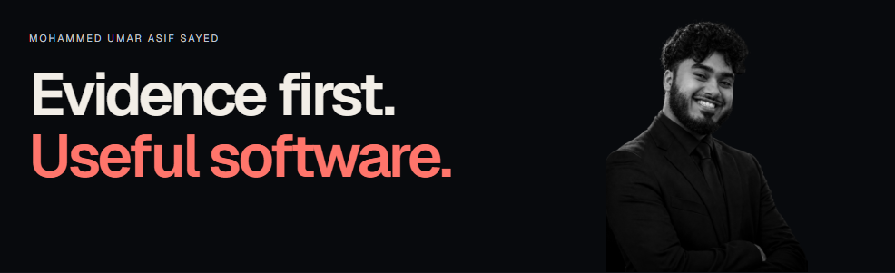
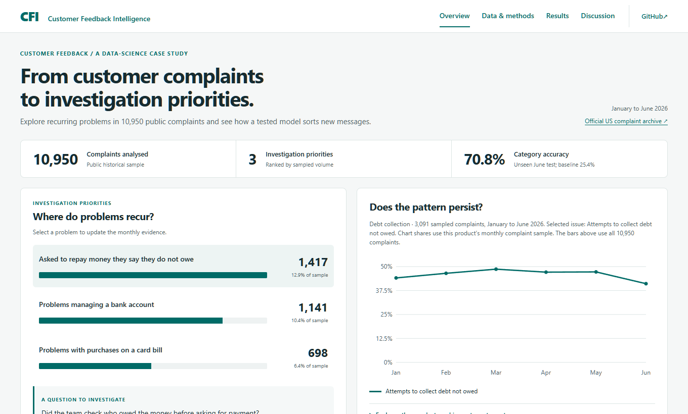
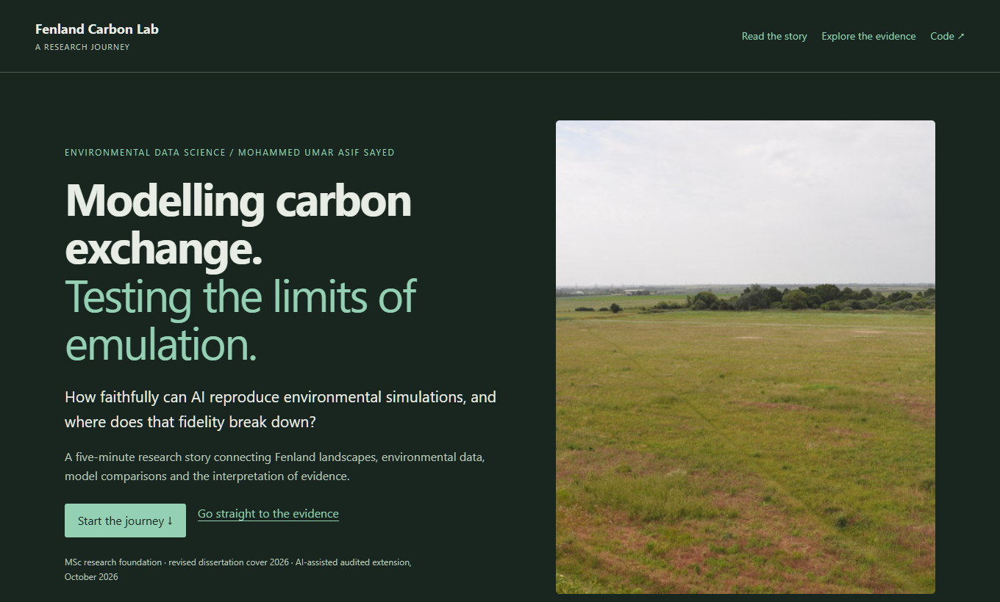

## Applied data science, with quality at the core.

I investigate real questions with analytics, Earth observation and machine learning. AI-assisted software and testing make the work usable; transparent review makes its limits visible.

[Selected work](#selected-work) · [Review & learning](#review--learning) · [Research direction](#research-direction) · [Experience & CV](https://mohammed-umar-sayed.vercel.app/en) · [Contact](https://www.linkedin.com/in/mohammedumarasif/)

## Selected work

<table>
<tr>
<td width="50%" valign="top">

ANALYTICS &amp; DATA QUALITY

<h3><a href="https://github.com/MohammedUmarAsif/customer-feedback-intelligence">Customer Feedback Intelligence</a></h3>

Which recurring complaints deserve investigation, and which routing predictions need review?

Public-data prototype. Quality exclusions and chronological evaluation are visible; personal reproduction and error review remain pending.

<a href="https://mohammedumarasif.github.io/customer-feedback-intelligence/">Explore the study</a> / <a href="https://github.com/MohammedUmarAsif/customer-feedback-intelligence/blob/main/docs/contributions.md">Review record</a>

</td>
<td width="50%" valign="top">

ENVIRONMENTAL MODELLING &amp; RESEARCH

<h3><a href="https://github.com/MohammedUmarAsif/fenland-carbon-lab">Fenland Carbon Lab</a></h3>

How faithfully can a carbon-flux emulator reproduce JULES, and where does generalisation break?

An AI-assisted extension of my MSc work. Simulator agreement is distinguished from real-world accuracy and impact.

<a href="https://mohammedumarasif.github.io/fenland-carbon-lab/">Read the research</a> / <a href="https://github.com/MohammedUmarAsif/fenland-carbon-lab">Code &amp; protocol</a>

</td>
</tr>
</table>

### [Flight Review](https://github.com/MohammedUmarAsif/aviation-decision-support)

Delay burden, competing priorities and a model that failed to beat its simple baseline. Independent research with operational limits stated.

[Explore the study](https://mohammedumarasif.github.io/aviation-decision-support/) / [Review record](https://github.com/MohammedUmarAsif/aviation-decision-support/blob/main/docs/contributions.md)

### [SolGeo: Urban-Change Review](https://github.com/MohammedUmarAsif/solgeo-uae-urban-edge)

Seven reusable modules for geospatial evidence, human correction and spatial validation. Synthetic integration demo; real-world validation is next.

## Review & learning

### Build it. Question it. Learn from it.

**AI assistance, with visible ownership.** Each project should distinguish generated implementation, executed checks and what I have personally reviewed or reproduced.

**Quality before confidence.** I care about source provenance, baselines, failure cases, manual testing and automated checks.

**Study that connects to practice.** [Engineering Knowledge Atlas](https://github.com/MohammedUmarAsif/engineering-knowledge-atlas) supports deliberate learning. [GeoForge AI](https://github.com/MohammedUmarAsif/GeoForge-AI) demonstrates a paused full-stack workbench milestone.

## Research direction

### Environmental evidence today. Interactive systems next.

The connecting question: **how can imperfect observations become decisions people can inspect and trust?**

I want to extend this work toward player feedback, game telemetry and adaptive systems, preparing for PhD research in Japan and a longer-term career in games-industry insights or analytics, including Capcom.

These are future directions. I welcome methods criticism, replication, data validation and collaboration on a focused next experiment.

---

Open to applied data science opportunities and research collaboration. [Contact](https://www.linkedin.com/in/mohammedumarasif/).
